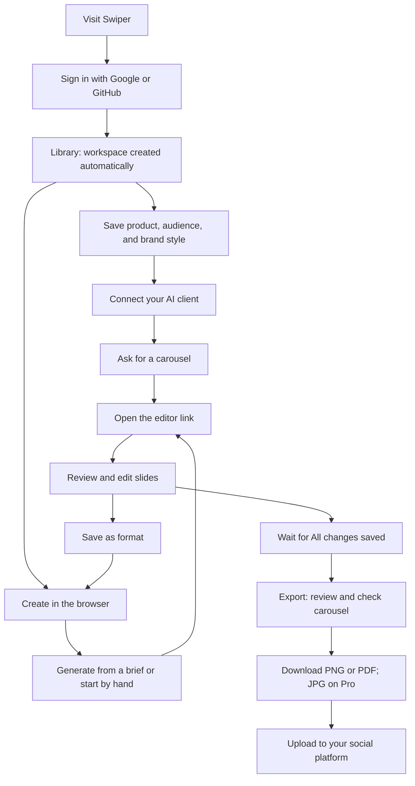

# How to use Swiper

Updated 15 October 2026, after the audit repair passes. This documents the implemented product. Customers can read the main journey at `/guide`.

Swiper helps people who use AI agents make editable social carousels. The agent creates a draft; the user reviews, edits, and downloads it in Swiper. Browser generation and manual creation are also available. A successful first session ends with a reviewed carousel downloaded as images or a PDF.

## The workflow

## Where to go

| Screen | Purpose | Next action |
| --- | --- | --- |
| Home `/` | Understand the product and see examples | Start for free or create a carousel |
| Sign up `/signup` / sign in `/login` | Continue with Google or GitHub | Return to the intended page, or the library |
| Library `/library` | Get started, find drafts, see allowances | Set up the brand, connect an agent, or open a draft |
| Brand kit `/brand` | Save product context and visual defaults | Save brand, then connect your agent |
| Connect `/connect` | Create a private key and install a client | Copy the first prompt and check the connection |
| Formats `/formats` | Preview official/saved formats, search, rename and delete saved designs | Use a format manually or write from a brief |
| Client guide `/guide/{client}` | Public Cursor, Claude or ChatGPT prerequisites and setup | Continue to the selected client in Connect, preserving auth return paths |
| Support `/support` | Get help without requiring a mail application | Email support or copy the address |
| Create `/new` | Generate from a brief or create manually | Open the editable draft |
| Editor `/c/{id}` | Review, edit, reorder, save, and export | Check the carousel and download files |
| Account `/account` | Manage billing or permanently remove the account | Typed confirmation erases owned workspaces; pending subscription cancellation is disclosed |
| Pricing `/pricing` | See allowances and upgrade | Complete checkout and wait for confirmation |
| Guide `/guide` | Read the usage guide | Follow a link to the next step |

## 1. Create your workspace

Choose **Start for free** and continue with Google or GitHub. Swiper creates a workspace and initial brand defaults automatically; there is no separate workspace or project creation form. If the provider did not supply a required name, the account-completion page asks for it. You arrive in the library unless you originally followed a link to another protected page; sign-in keeps that destination.

The library links to brand setup, agent connection, and a first draft. Once you have a carousel, setup collapses so saved drafts are easier to reach. Choose **Show setup** to reopen it.

Progress reflects saved data: brand setup is done when a description and audience are saved; agent setup is done when an active key has actually been used. Creating a key alone does not prove the connection works.

## 2. Save your brand kit

1. Open **Brand kit**. Enter your product name, what it does, and its audience. Only the name is required; description and audience improve generated copy.
2. Choose background, primary text, secondary text, and accent colors. Choose heading and body fonts. Use the live preview to inspect changes.
3. Optionally upload a PNG, JPEG, or WebP logo, up to 8 MB.
4. Open **More voice and writing settings** for positioning, tone, default call to action, website, preferred and forbidden words, verified proof points, and writing guidelines.
5. Choose **Save brand**, wait for **Saved**, then follow **Next: connect your agent**.

New carousels use the saved defaults. Existing drafts keep their current design. Saved formats retain the design, copy, and images they were saved with.

If the brand cannot load, retry before editing; the app does not substitute an empty editable form. Following another in-app link with unsaved edits opens a choice to **Keep editing** or **Discard and leave**. Reloading or closing the tab can trigger the browser's unsaved-changes prompt. Save before using browser history navigation.

## 3. Connect an agent

1. Open **Connect** and choose **Mint API key**.
2. Use **Copy private key** and save it privately. The full secret is shown once and is not stored in the browser for later retrieval.
3. Select the **Cursor**, **Claude**, or **ChatGPT** tab. Only the selected client's configuration is shown. Tabs also work with arrow keys.
4. Follow that client's setup:
   - **Cursor:** use **Add to Cursor**, or copy the JSON into MCP settings. It uses `/mcp` with an Authorization header.
   - **Claude:** add a custom connector, choose No sign in, and add the Authorization request header. Enable it in the conversation. **Using Claude Code instead?** contains the terminal command. The separate local-process section supports Claude Desktop's local configuration.
   - **ChatGPT:** add a custom MCP app or plugin using the URL in the panel. If asked, choose No authentication. The URL's `?key=` value authenticates requests to Swiper. Keep the entire URL private.
5. Open a new conversation and paste **Copy first prompt**.
6. After the agent's first request, choose **Check connection** in Swiper. Status distinguishes a waiting key from one an agent has used.

Cursor, Claude Code, and a local Claude Desktop process can reach local Swiper. Hosted Claude connectors and ChatGPT require a public HTTPS address. Client setup availability depends on the client's current account and workspace settings; the panels link to official instructions.

After refresh, setup templates remain available, but you must insert the secret you saved. If you lost it, mint a new key. **Revoke** asks for confirmation and immediately removes that key's access without deleting carousels.

## 4. Ask for a draft

Give your agent a specific topic, audience, and takeaway. For example:

> Use Swiper to read my brand kit and create a carousel explaining the main problem my product solves. Choose a suitable story format, write clear original copy, run quality checks, and give me the editor link to review it.

The agent reads brand context, selects a format, creates or modifies slides, and checks the result. Open its editor link, or find the draft in **Library**. Iterate in the conversation: “Shorten the opening,” “Replace this claim with my verified proof point,” or “Change the final call to action.”

Agent requests and manual edits use the same workspace. If another client changes a draft while you edit, Swiper detects the version conflict rather than silently overwriting it.

## 5. Create directly in the browser

### Generate from a brief

1. Open **Create → Generate from a brief**.
2. Describe the post in at least 12 non-whitespace characters. Include topic, audience, and takeaway. Example buttons provide a starting brief.
3. Optionally add a public HTTPS LinkedIn, X, Threads, or Instagram reference post. Swiper uses available public metadata as structural context and writes original copy. It does not promise to extract every slide. An unreadable post falls back to the brief and produces an editor notice.
4. Optionally name the carousel and select **Story shape**.
5. Review the outline, slide-count range, and allowance cost in **Your draft**.
6. Choose **Generate carousel**. The draft opens in the editor automatically. If the request times out or the response is lost, return in the same tab to recover the completed result or retry the same request.

An unfinished brief, title, reference, creation method, and format choices are saved in this tab's session storage, scoped to the workspace brand. Refreshing or returning in the same tab restores them. Successful creation clears that temporary brief. Closing the tab or disabling browser storage can remove this recovery; it is not a cross-device draft.

### Start by hand

Choose **Start by hand**, select a blank canvas, saved workspace format, or official story format, optionally give it a title, and choose **Open in editor**. A blank canvas starts with three editable slides. The editor supports up to 12 slides.

Both methods use one carousel slot. A successful model generation also uses one AI generation; a local fallback does not. Starting by hand remains available after AI allowance is exhausted, provided a carousel slot remains.

## 6. Review and edit

1. Select a slide in the navigator, then select text or an image on the canvas.
2. Edit content and properties in the design panel. On mobile, the panel appears below the canvas.
3. Drag to move, use handles to resize, or use arrow keys to nudge a selected element. Change the slide background in the design panel.
4. Add text or upload images from the toolbar. Reorder, add, duplicate, or delete slides. Keep at least one slide and one element per slide.
5. Use **Undo** or Cmd/Ctrl+Z outside text fields to reverse a saved edit. The most recent 100 saved snapshots are retained. Redo is not implemented.
6. Wait for **All changes saved**. Autosave persists pending edits locally and retries transient failures.

If saving fails, keep the tab open and choose **Retry save**. For a version conflict, **Download local draft** saves the complete local document, its original server base, and pending edits as recovery JSON. **Load latest version** discards pending local edits and loads server content. Restore your saved file through **More carousel options → Restore local backup**, review the replacement warning, and choose **Restore backup**. The current saved version remains available through Undo. Recovery JSON is a backup, not a social export; images still depend on the original workspace's uploaded assets.

Agent slide revisions use the latest editable copy and preserve existing design, images, logos, IDs, and other slides. If the carousel changes while a model revision is running, the agent receives a conflict and must read the latest version before trying again. Agents can pass a `request_id` when creating or revising to retry without duplicating the work.

## 7. Export and share

Choose **Export**. Read the hook, verify claims and facts, and check the closing call to action. Choose **Check carousel** for automated checks of the current saved version. It flags rules such as dense text, out-of-bounds elements, generic copy, and unverified-looking claims. **Edit slide N** returns to the relevant slide. After editing, old results are hidden; save and check again.

| Download | Result | Next action |
| --- | --- | --- |
| PNG images | ZIP of numbered 1080 × 1350 images | Unzip and upload slides in order |
| PDF document | One document, one page per slide | Upload as a LinkedIn document post |
| JPG images, Pro | ZIP of slide images | Unzip and upload; smaller files |

Latest edits save before downloading. Free users see the JPG upgrade path before a request. PNG and PDF remain available on Free within allowance. Automated checks help with defined rules; they do not fact-check every claim or certify visual quality. Exporting a manual draft does not require a clean content check.

You upload the result yourself. Swiper does not connect social accounts, schedule or publish posts, or report social performance in this release. Pro and Studio add higher limits and JPG downloads. Checking and file handoff are part of Export.

## 8. Reuse and return

Open **More carousel options → Save as format**, name the format, and save. Find it under **Your workspace formats** in **Start by hand**. Each manual use creates an independent copy. Eligible formats also appear in generation: fresh headline/kicker/body/proof/CTA copy uses your saved design and images; fixed labels and captions remain. Formats without unambiguous writable copy slots are manual-only.

The library loads drafts in pages of 25 and shows first-slide previews, slide counts, titles, and dates. Search by title or official format name, sort by recent edits or title, and open a draft to resume. **Clear search** recovers from no results. Deleting a carousel requires confirmation and permanently removes its edit history; saved formats remain.

## Plans and recovery

| Monthly allowance | Free | Pro | Studio |
| --- | ---: | ---: | ---: |
| Price (USD/month) | $0 | $29 | $79 |
| Carousels | 5 | 30 | 100 |
| AI generations/revisions | 10 | 50 | 150 |
| Exports | 20 | 200 | 600 |
| JPG export | No | Yes | Yes |

Allowances reset on the first day of each month in UTC. Deleting a carousel created this month frees its slot; generation and export usage stay counted. Deleting an older carousel does not free a current-month slot.

A failed or limited generation keeps the brief. Retry a failed generation or export from its corresponding action. Library, brand, formats, and plan loading errors offer retries. An inaccessible editor link offers a way back to the library. Sign-in failures show recovery instead of remaining indefinitely on a loading screen; a blocked provider must still be fixed in the live authentication configuration.

To upgrade, open Pricing, continue to checkout, and wait for payment confirmation. The return URL alone does not prove the plan changed. Pricing refreshes the plan and offers a manual refresh while confirmation is pending. Each displayed paid price must match its configured payment product; checkout verifies currency, amount and monthly cadence. When paid checkout is unavailable, the cards offer an email access request instead of a broken payment action. When a customer is linked, **Manage subscription** opens the billing portal. Contact **milan@cassettelabs.in** for billing/support help. The operator is **MILAN SAMPATH**; approved privacy and terms pages remain a launch requirement.

## References and verification limits

Client instructions were checked against the official [Claude connector guide](https://support.claude.com/en/articles/11175166-get-started-with-custom-connectors-using-remote-mcp), [Claude Code MCP guide](https://code.claude.com/docs/en/mcp), and [OpenAI custom MCP guide](https://developers.openai.com/api/docs/guides/custom-mcp-server). Connection snippets and clipboard behavior were tested locally. Successful hosted-client connections and real Google/GitHub sign-in still need live smoke tests; see [the readiness review](22-ux-review-and-readiness.md).
